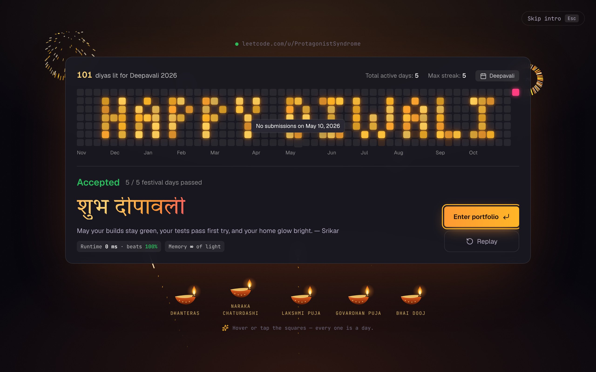
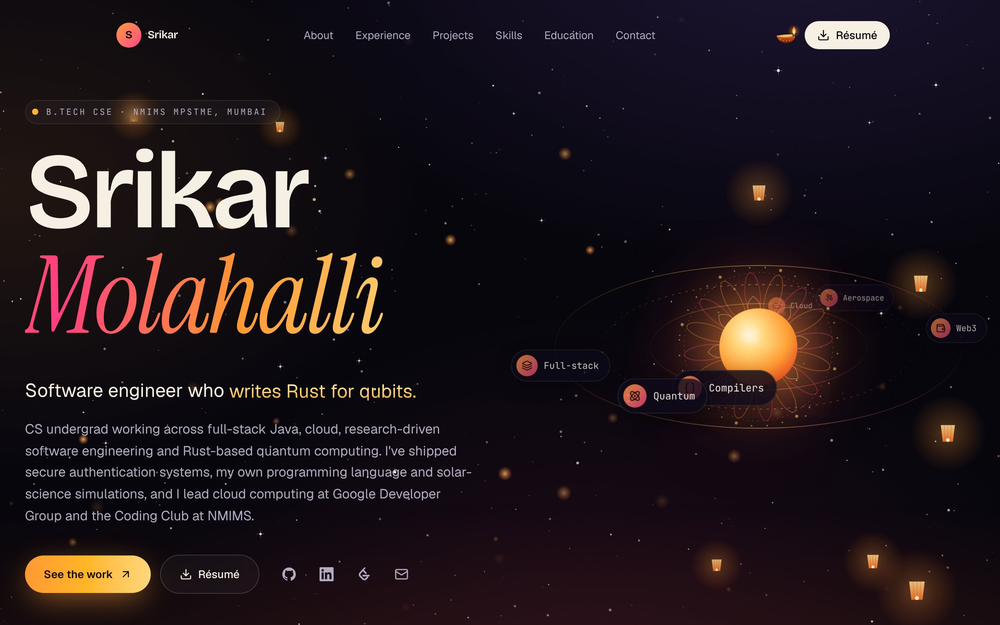
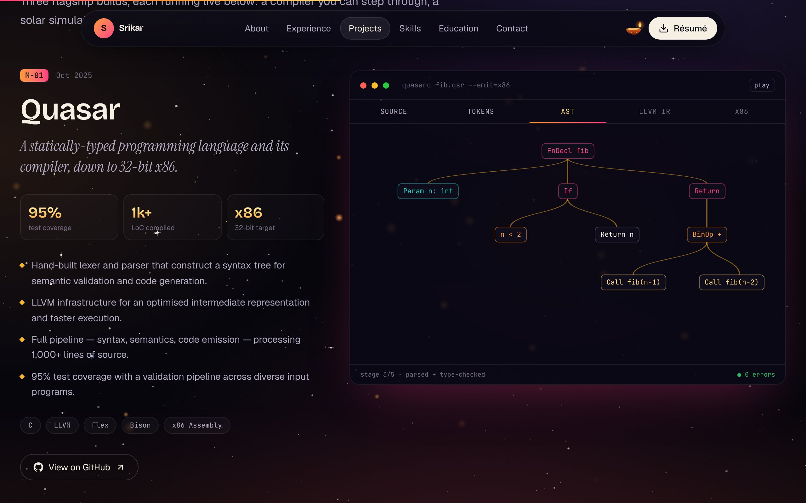

# Srikar Molahalli — Portfolio v2

**Live:** https://srikar-knightark007-portfolio.vercel.app

A hand-built, animation-heavy portfolio: deep-space night sky, Diwali lights, and live simulations of the projects themselves.

<p align="center">
  
</p>

## What's on the page

| | |
|---|---|
| 🪔 **Diwali greeting** | On first open, a LeetCode-style submission heatmap fills with a year of green "submissions". Then the squares spelling **HAPPY DIWALI** ignite as diyas, an *Accepted* verdict appears with शुभ दीपावली, and fireworks go up. Every square is a real date with a hover tooltip. It shows once per session; the diya in the nav (or `diwali` in the terminal) replays it. |
| 🌌 **Night sky** | One canvas behind everything: parallax starfield, shooting stars, rising embers, sky lanterns, and fireworks you launch by clicking the sky. |
| 🪐 **Hero orrery** | Focus areas orbit a rangoli sun in pseudo-3D, tilting with the mouse. |
| 🛰️ **Experience** | A scroll-drawn flight-log timeline. Collins Aerospace gets a live CI/CD pipeline, IISER Kolkata a soft-landing trajectory simulation, and each role has animated impact bars. |
| 🚀 **Projects** | **Quasar**: step through source → tokens → AST → LLVM IR → x86. **Solar simulator**: drag the day and latitude to get real declination, noon elevation, day length and the sun's path. **Borderless**: remittance packets routed through an on-chain hub. |
| ✨ **Also** | Skill constellations, a graph-database visual for the publication, a certifications wall, and a working mini terminal (`help`, `cd projects`, `sudo hire srikar`…). |

<p align="center">
  
  
</p>

Respects `prefers-reduced-motion` (static frames, no auto-advance), pauses canvases that are off-screen or in a hidden tab, and works down to 360 px wide.

## Editing content

**Everything lives in [`lib/data.ts`](lib/data.ts).** Experience, projects, skills, certifications, links and copy are all there; the components only render it.

- **Turn the Diwali greeting off** after the season: set `festival.enabled = false` in `lib/data.ts`. Lanterns, auto-fireworks and the footer diyas switch off with it.
- **Résumé:** replace `public/Srikar_Molahalli_Resume.pdf`.
- **Quasar's GitHub link** points at the profile; set `projects[0].link` to the repo once it's public.

## Stack

Next.js 16 (App Router, statically prerendered) · React 19 · Tailwind CSS 4 · Motion · Canvas 2D · TypeScript. No UI kit; fonts via `next/font` (Bricolage Grotesque, Instrument Serif, Geist, JetBrains Mono, Tiro Devanagari Hindi).

```
app/            layout (metadata, JSON-LD), page, OG image, icon, robots, sitemap
components/
  greeting/     the heatmap Diwali intro
  fx/           night-sky canvas
  hero/         hero + orrery
  sections/     about, experience, projects, skills, education, contact
  viz/          compiler, solar, defi, pipeline, descent visualisations
  ui/           reveal, counter, spotlight card, icons, headings
lib/            data.ts (content), fireworks engine, pixel font, utils
```

## Run locally

Requires Node 20.9+.

```bash
npm install
npm run dev        # http://localhost:3000
npm run build      # production build (also type-checks)
```

## Deploying on Vercel

The project deploys with Vercel's defaults (framework **Next.js**, install `npm install`, build `next build`). If the project was set up for the old v0 code, check **Settings → Build & Deployment** and clear any overridden install command (e.g. `pnpm install`) so Vercel uses `package-lock.json`.

What was fixed from v1:
- an empty `pnpm-lock.yaml` that made `pnpm install --frozen-lockfile` fail → replaced with a real `package-lock.json`
- Next.js 15.2.4 (affected by critical security advisories that Vercel blocks deploys for) → Next.js 16.4.5, all deps pinned, `npm audit` clean
- duplicate `next.config.js`/`.mjs` and `postcss.config.js`/`.mjs` → one of each
- `ignoreBuildErrors` / `ignoreDuringBuilds` hiding broken code → removed; the build type-checks
- `"latest"` dependency versions and a React 19 peer-dependency conflict → pinned, conflict removed
- background image hot-linked from v0 blob storage → no external runtime assets
- a Ballerina `.gitignore` that didn't ignore `node_modules`/`.next` → Next.js `.gitignore`
- added metadata, Open Graph image, sitemap, robots, JSON-LD and security headers

## License

[Apache 2.0](LICENSE)
